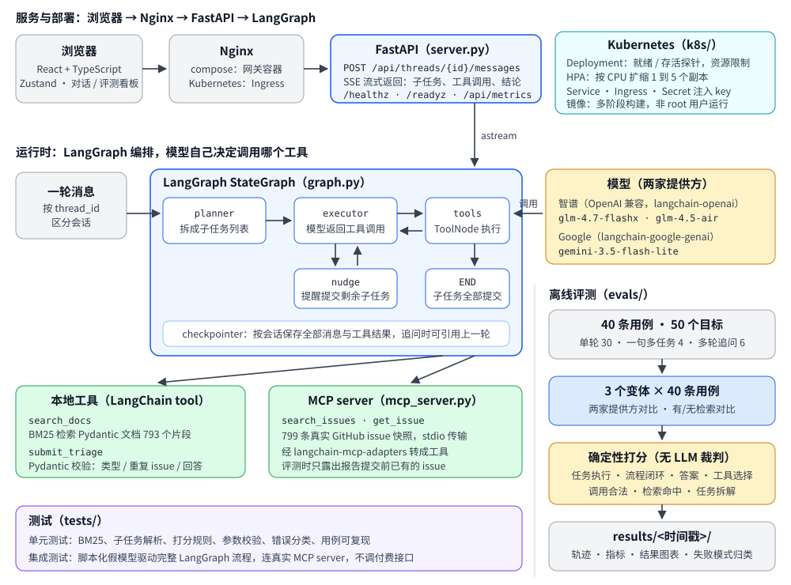
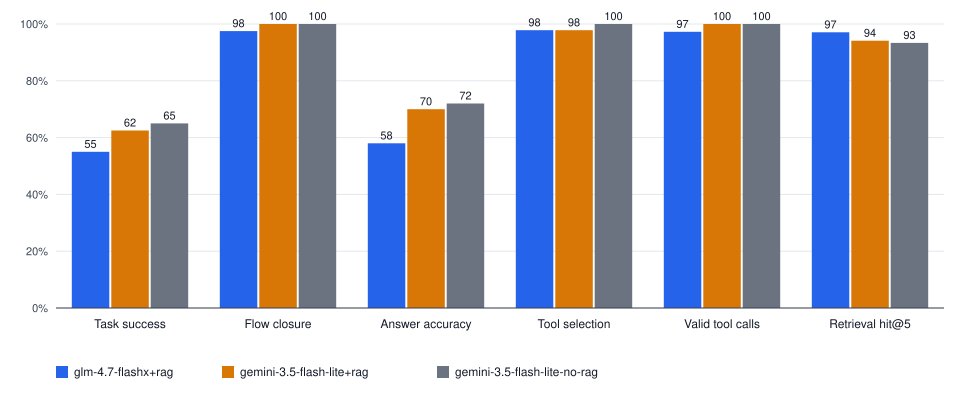

# triage-agent：开源项目的文档问答与 issue 分诊 Agent

一个用 LangGraph 编排、会自己挑工具的多轮对话 Agent，加一套能一条命令重跑的评测。它替开源项目维护者处理进来的请求：用户问「这个功能怎么用」，它查官方文档给出具体的 API 或配置项；用户提交 issue 报告，它去已有 issue 里找有没有重复，判断这是 bug、功能请求、文档问题还是用法提问；一条消息里夹着几件事时，它先拆成子任务再逐个完成；用户追问上一轮的内容时，它记得自己说过什么、查过什么。

示例项目是 Python 数据校验库 [Pydantic](https://github.com/pydantic/pydantic)，所有数据都来自它的公开文档和公开 issue。

## 1 解决什么问题

### 1.1 场景与业务价值

热门开源项目的 issue 区有一大块工作是重复劳动：同一个问题被不同的人反复提，用法问题被当成 bug 提交。维护者每天要先读完、搜一遍旧 issue、贴上标签、关掉重复项，才轮到真正需要修的问题。Pydantic 仓库里被维护者手工标成 duplicate 的 issue 就有一百多条，没标出来的更多。

这个 Agent 做的是维护者的第一道筛选：

- 用法提问：直接用文档回答，指出具体的 API 名或配置项
- 重复报告：找到最早的那条 issue，给出编号
- 新报告：给出类型，交给人处理
- 一条消息多件事：拆成子任务，每件给出一个结论
- 追问：基于上一轮的回答和查到的 issue 继续回答（例如「你说的那条 issue 是什么时候提的」）

这套流程不限于 Pydantic。换成任何一个有文档和 issue 区的项目，只需要替换 `data/` 里的两份数据；企业内部的工单系统、客服知识库也是同一个结构。

### 1.2 为什么 Agent 是主角、检索只是一个工具

文档检索（RAG）在这里只是 Agent 手里的一个工具。真正的难点是决策：这条消息里有几件事、每件该查文档还是查 issue、搜不到要不要换关键词、搜到的候选是不是同一个问题、什么时候停下来给结论。所以项目的重心放在四件事上：

1. 任务拆解：先把消息拆成子任务，再逐个执行，每个子任务单独提交结论
2. 工具调用：模型通过 function calling 自主决定调用哪个工具、调几次；issue 查询以 MCP server 的形式提供，任何支持 MCP 的客户端都能直接复用
3. 多轮对话：会话状态由 LangGraph 的 checkpointer 保存，追问时能引用上一轮的结论和工具结果
4. 可度量：任务执行准确率、流程闭环率、答案正确率、工具选择与调用、检索命中、任务拆解都有确定性的评测

## 2 架构



*图 1 架构：最上一行是服务路径，浏览器经 Nginx（compose 网关或 Kubernetes Ingress）调用 FastAPI，FastAPI 把 LangGraph 每个节点的进展以 SSE 流式返回，右上是 Kubernetes 上的部署对象；中间左侧是 LangGraph 状态图，planner 拆子任务，executor 调模型拿到工具调用，ToolNode 执行本地工具和 MCP 工具，子任务全部提交后结束本轮，checkpointer 保存多轮记忆；模型经 LangChain 接入智谱和 Google 两家；右侧是离线评测流程，复用同一个 Agent。*

| 组件 | 文件 | 做什么 |
|---|---|---|
| 状态图 | `src/triage_agent/graph.py` | 节点 `planner`（把消息拆成子任务，输出 JSON 列表）、`executor`（带工具调用模型）、`tools`（LangGraph `ToolNode`）、`nudge`（模型只回文字或步数用完时，提醒它提交剩余子任务）；条件边按「子任务是否都已提交」决定继续还是结束 |
| 会话 | `src/triage_agent/agent.py` | 一个会话对应一个 checkpointer 线程；每轮结束后从状态里抽出轨迹：计划、每次工具调用的参数与结果、提交的结论、token 用量、耗时 |
| 本地工具 | `src/triage_agent/tools.py` | `search_docs`：自己实现的 BM25，索引 Pydantic 文档切出的 793 个片段；`submit_triage`：用 Pydantic 模型定义参数，类型不对或缺字段时 ToolNode 把错误回传给模型，让它自己改 |
| MCP server | `src/triage_agent/mcp_server.py` | 官方 MCP Python SDK（FastMCP）写的 server，stdio 传输，提供 `search_issues` 和 `get_issue`，数据是 799 条真实 issue 的快照；Agent 端用 `langchain-mcp-adapters` 把它转成 LangChain 工具 |
| 模型 | `src/triage_agent/config.py` | 智谱 GLM-4.7-FlashX、GLM-4.5-Air 走 OpenAI 兼容接口（`langchain-openai`）；Google Gemini 3.5 Flash-Lite 走 `langchain-google-genai` |

MCP server 可以单独启动，接到 Claude Desktop、Cursor 这类客户端上用：

```bash
.venv/bin/python -m triage_agent.mcp_server
```

### 2.1 为什么选 LangGraph

选 LangGraph 而不是 LangChain 的 AgentExecutor，是因为这个任务的流程需要显式控制：先规划再执行、按「子任务是否都已提交」决定何时结束、步数用完时只给模型留提交工具，这些都要写成图里的节点和条件边才清楚、可测；多轮记忆直接用 LangGraph 自带的 checkpointer，不用自己管理对话历史。

### 2.2 两家模型提供方

Agent 的代码只依赖 LangChain 的 `BaseChatModel` 接口，模型提供方在 `config.py` 里配置：智谱是国产模型，走 OpenAI 兼容接口；Google Gemini 走官方的 LangChain 集成。Gemini 3 系列在多轮工具调用时要求把上一轮返回的 thought signature 原样带回，OpenAI 兼容接口会丢掉它并返回 400，所以 Gemini 用原生集成。新增一家提供方只需在 `config.py` 里加一行。

## 3 怎么跑

需要 Python 3.11+、[uv](https://docs.astral.sh/uv/)，以及至少一个模型的 API key：[智谱开放平台](https://open.bigmodel.cn/)（`ZHIPUAI_API_KEY`），或 [Google AI Studio](https://aistudio.google.com/)（`GEMINI_API_KEY`，免费额度即可跑 Gemini 变体）。

```bash
make install
export ZHIPUAI_API_KEY=...        # 或写进仓库根目录的 .env（已在 .gitignore 里）
export GEMINI_API_KEY=...
```

```bash
make all      # 单元测试 + 集成测试 + Agent 演示 + 完整评测，一条命令跑完
```

也可以分步跑：

| 命令 | 做什么 |
|---|---|
| `make test` | 单元测试和集成测试，不调付费接口，约 3 秒 |
| `make demo` | 两轮对话演示：第一轮一句话问两件事，第二轮追问上一轮查到的 issue |
| `make chat` | 交互式多轮对话，`--model` 可换模型 |
| `make smoke` | 每类取 2 条用例、跑 1 遍，检查链路 |
| `make eval` | 完整评测，结果写进 `results/<UTC 时间戳>/`，并把结果表同步进本 README |
| `make report` | 最新一次评测的失败模式归类 |
| `make serve` / `make web` | HTTP 服务和前端开发服务器，部署见第 6 节 |
| `make data` | 从 GitHub 重新抓取文档和 issue 快照（需要已登录的 `gh`），再生成用例 |

`.venv/bin/triage-agent --model gemini-3.5-flash-lite` 的一次真实输出（节选，检索结果只留前 3 条，长回答截断）。第一轮一条消息里有两件事，planner 拆成两个子任务，Agent 先查文档、再换几组关键词查 issue，两个子任务各提交一个结论；第二轮追问「你看的那条 issue」，Agent 记得第一轮的结论是「没有找到已有 issue」，据此作答。

```text
=== turn 1: Two things. First, how do I drop every None value when I dump a model to a dict? Second, a bug repor...
plan: ["How do I drop every None value when I dump a model to a dict?",
       "Is it a known bug that model_dump(exclude_defaults=True) drops a field with a custom field_serializer ...?"]
[1] search_docs({"query": "model_dump exclude none"})  [local, ok]
      -> docs/concepts/serialization.md#30
[2] search_issues({"query": "model_dump exclude_defaults field_serializer"})  [mcp, ok]
      -> #12888 model_dump(exclude_unset=True) produces spurious warnings for Union me
      -> #13733 Allow excluding defaults for specific values in serialization
      -> #10683 `exclude_defaults` is broken for Optional fields with `default_factory
[3]-[5] search_issues(...)  换了三组关键词  [mcp, ok]
[6] submit_triage({"subtask": 1, "type": "question", "answer": "... pass exclude_none=True to model_dump() ..."})  [local, ok]
[7] submit_triage({"subtask": 2, "type": "bug", "duplicate_of": null, "answer": "This is not a currently tracked or known bug ..."})  [local, ok]
6 LLM calls, 20870 in / 403 out tokens, 92.89s, stop=closed

=== turn 2: For the issue you looked at, when was it opened and is it still open?
plan: ["When was the bug report about model_dump(exclude_defaults=True) dropping a field ... opened, and is it still open?"]
[1]-[2] search_issues(...)  [mcp, ok]
[3] submit_triage({"subtask": 1, "type": "question", "answer": "As mentioned, there is actually no existing bug report for this specific interaction ..."})  [local, ok]
4 LLM calls, 24717 in / 152 out tokens, 61.59s, stop=closed
```

`stop=closed` 表示本轮计划里的每个子任务都提交了结论，即流程闭环。

每次评测的输出目录：

| 文件 | 内容 |
|---|---|
| `config.json` | 用例数、变体、重复次数、花费上限、总花费、总耗时 |
| `traces.jsonl` | 每个变体 × 每条用例 × 每次重复的完整轨迹：每轮的计划、每一步的工具、参数、返回结果、提交的结论、token |
| `metrics.json` | 各变体的汇总指标、按用例类别和目标类型的分项指标 |
| `results_table.md` / `results_chart.svg` | 结果表和结果图 |
| `failure_modes.md` | 每个未达成目标的失败模式归类 |
| `run_<时间戳>.log` | 运行日志 |

`make eval` 有一个花费上限（默认 0.4 美元，`--budget-usd` 可改）：付费模型的累计花费达到上限后不再启动新用例，免费模型照常跑完，日志里报告跳过了多少。每条用例跑完立即追加写入 `traces.jsonl`，进程中途被杀时用 `--resume results/<时间戳>` 接着跑，已完成的用例不重跑、已花的钱计入上限。遇到限流、过载这类服务端错误的用例会整条重跑，最多 3 次；请求本身有错（400）不重跑，按失败计入。

## 4 评测

### 4.1 测试集

`evals/cases.jsonl` 共 40 条用例、50 个评分目标，由 `scripts/build_cases.py` 从带标准答案的条目池 `evals/items.jsonl`（44 条）确定性地生成。

| 用例类别 | 条数 | 内容 |
|---|---|---|
| 单轮任务 | 30 | 文档问答 10、重复 issue 10、新 issue 10，每条一个目标 |
| 一句多任务 | 4 | 一条消息里同时有一个用法问题（或用法提问）和一份 issue 报告，Agent 要先拆成两个子任务 |
| 多轮追问 | 6 | 第一轮是文档问题或重复 issue 报告；第二轮追问只有记得第一轮才能回答，例如「你给的那条 issue 是什么时候提的」「那这个属性怎么给每个实例一个新的默认值」 |

条目池里的标准答案：

| 目标类型 | 来源 | 标准答案 |
|---|---|---|
| 文档问答 | 按 Pydantic 文档写的用法问题，问题里不出现答案的 API 名 | 回答必须提到的 API 或配置项；答案所在的文档页 |
| 重复 issue | 真实 issue：维护者标成 duplicate 并在评论里指出了原 issue | 原 issue 编号 |
| 新 issue | 真实 issue：维护者已贴类型标签，修复后关闭 | 类型（bug / feature_request / documentation / question），且不应判成重复 |
| 追问事实 | 原 issue 的提交日期 | 日期（接受几种常见写法） |

两条防泄漏规则：

1. 作为问题的 28 条 issue 不进 issue 库。
2. 每条 issue 类用例只能看到在它之前提交的 issue（按编号截断），和维护者当时看到的情况一致。MCP server 通过环境变量 `TRACKER_BEFORE` 实现这条截断。

GitHub 上的重复关系标注并不完整，所以 28 条 issue 类条目的标准答案都经过人工核对：对每条检索它之前提交的相似 issue，逐条阅读。其中 2 条存在第二个可接受答案（例如同一个报错更早就被报过），写进了条目的 `acceptable_duplicates` 字段并附理由。

### 4.2 指标

全部指标都用确定性规则从轨迹算出，不用 LLM 当裁判，同一份轨迹任何时候重算结果都一样（`evals/metrics.py`）。

| 指标 | 单位 | 定义 |
|---|---|---|
| 任务执行准确率 | 用例 | 用例里所有轮次的所有目标都达成的比例，即端到端做对 |
| 流程闭环率 | 用例 | 用例里每一轮都闭环的比例：计划中的每个子任务都调用 `submit_triage` 提交了结论，没有报错、没有停在步数上限 |
| 最终答案正确率 | 目标 | 文档题：类型为 question 且回答提到全部必需的 API；重复题：给出的编号在可接受答案里；新 issue 题：类型正确且没有判成不可接受的重复；追问事实：回答里有正确日期 |
| 工具选择正确率 | 轮次 | 该轮目标需要的工具都调用了（文档题 `search_docs`，issue 题 `search_issues`；变体里没提供的工具不计） |
| 工具调用合法率 | 调用 | 参数满足工具 Schema、执行成功的调用占全部调用的比例 |
| 检索命中率 | 目标 | 该轮任意一次检索的前 5 条结果里出现了标准答案所在的文档页或原 issue |
| 任务拆解正确率 | 轮次 | 单轮和一句多任务用例里，planner 拆出的子任务数等于该轮目标数的比例 |
| 误判重复率 | 目标 | 新 issue 目标里，被判成不可接受的重复的比例 |

### 4.3 变体

| 变体 | 提供方 | 模型 | 工具 | 比较什么 |
|---|---|---|---|---|
| `glm-4.7-flashx+rag` | 智谱（国产） | GLM-4.7-FlashX（关闭思考模式） | 文档检索 + MCP issue 工具 | 与下一行比较两家提供方 |
| `gemini-3.5-flash-lite+rag` | Google | Gemini 3.5 Flash-Lite | 文档检索 + MCP issue 工具 | |
| `gemini-3.5-flash-lite-no-rag` | Google | Gemini 3.5 Flash-Lite | 只有 MCP issue 工具 | 与上一行比较有无文档检索 |

每个变体对 40 条用例各跑 1 遍，temperature 为 0（Gemini 3.5 Flash-Lite 不接受 temperature，用官方固定采样）。花费按 [Z.ai 官方价格](https://docs.z.ai/guides/overview/pricing)计算（GLM-4.7-FlashX 每百万 token 输入 0.07 美元、输出 0.4 美元，不计缓存折扣，是上限）；Gemini 用的是 Gemini API 的免费额度。`config.py` 里还配置了 GLM-4.5-Air，可用 `--model glm-4.5-air` 演示或加入评测。

### 4.4 结果

<!-- results:start -->
运行 `20261124T184625Z`：40 条用例（50 个目标）× 3 个变体，每个变体的重复次数见表，总花费 0.23 美元，耗时 50 分钟。原始轨迹、逐题打分和日志在 [`results/20261124T184625Z/`](results/20261124T184625Z/)。

| 变体 | 重复次数 | 任务执行准确率 | 流程闭环率 | 最终答案正确率 | 工具选择正确率 | 工具调用合法率 | 检索命中率 | 任务拆解正确率 | 误判重复率 | 每条用例平均耗时 (s) | 花费 (USD) |
|---|---|---|---|---|---|---|---|---|---|---|---|
| glm-4.7-flashx+rag | 1 | 55.0% | 97.5% | 58.0% | 97.8% | 97.2% | 97.1% | 50.0% | 0.0% | 132.01 | 0.2339 |
| gemini-3.5-flash-lite+rag | 1 | 62.5% | 100.0% | 70.0% | 97.8% | 100.0% | 94.1% | 100.0% | 0.0% | 38.71 | 0.0000 |
| gemini-3.5-flash-lite-no-rag | 1 | 65.0% | 100.0% | 72.0% | 100.0% | 100.0% | 93.3% | 100.0% | 0.0% | 148.66 | 0.0000 |

| 变体 | 单轮任务 执行准确率 / 闭环率 | 一句多任务 执行准确率 / 闭环率 | 多轮追问 执行准确率 / 闭环率 |
|---|---|---|---|
| glm-4.7-flashx+rag | 63.3% / 96.7% | 25.0% / 100.0% | 33.3% / 100.0% |
| gemini-3.5-flash-lite+rag | 73.3% / 100.0% | 25.0% / 100.0% | 33.3% / 100.0% |
| gemini-3.5-flash-lite-no-rag | 73.3% / 100.0% | 25.0% / 100.0% | 50.0% / 100.0% |

| 变体 | 文档问答 正确率 / 命中率 | 重复 issue 识别 正确率 / 命中率 | 新 issue 分类 正确率 | 追问事实 正确率 |
|---|---|---|---|---|
| glm-4.7-flashx+rag | 89.5% / 100.0% | 0.0% / 93.3% | 76.9% | 66.7% |
| gemini-3.5-flash-lite+rag | 94.7% / 100.0% | 33.3% / 86.7% | 69.2% | 100.0% |
| gemini-3.5-flash-lite-no-rag | 100.0% / n/a | 20.0% / 93.3% | 84.6% | 100.0% |



*图 2 评测结果：3 个变体在六项指标上的得分，各次重复合并计算。检索命中率合并了文档题（命中文档页）和重复题（命中原 issue），没有文档检索工具的变体只统计后者。*
<!-- results:end -->

### 4.5 结论

基于运行 `20261124T184625Z`，每个变体 40 条用例各 1 遍；一条用例约等于 2.5 个百分点。

1. 两家提供方：Gemini 3.5 Flash-Lite 的任务执行准确率 62.5%，GLM-4.7-FlashX 55.0%。差距主要来自任务拆解：FlashX 的 planner 把单条 issue 报告拆成「排查、复现、修复」多个子任务，拆解正确率只有 50%，未达成的 21 个目标里有 8 个属于拆解错误。拆分之后它的调用也更多：每条用例 12.75 次工具调用、317 万输入 token，Gemini 是 4.3 次、49 万。planner 提示加一条规则后，同一批 10 条用例上单子任务的比例从 2/10 升到 9/10，调用次数减半（[失败分析 3.1](docs/failure_analysis.md)）。
2. 流程闭环：三个变体的流程闭环率在 97.5% 到 100%。这来自图里的两道保障：模型只回文字时 `nudge` 节点提醒它提交，步数用完时只给它留下 `submit_triage` 一个工具。
3. 文档检索的作用：去掉文档检索后，Gemini 的任务执行准确率是 65.0%，文档问答正确率 100%，和有检索时（62.5%、94.7%）相差一两条用例。Pydantic 是热门库，模型自己就记得这些常用 API，所以在这个测试集上文档检索的价值没有体现在正确率上；要测出检索的价值，需要模型训练数据之外的知识，见第 7 节。
4. 主要瓶颈是重复 issue 的判断：原 issue 出现在检索结果里的比例是 86.7% 到 93.3%，给出正确编号的比例只有 0% 到 33.3%；三个变体各有 8 到 11 个目标属于「检索到了、判断错了」。三个变体都没做对的 13 条用例里，11 条含重复 issue 目标。这些用例的原 issue 与新报告症状不同、根因相同，只看标题和正文很难判断，改进方向见[失败分析 3.3](docs/failure_analysis.md)。
5. 耗时：Gemini 用的是免费额度，客户端限速每分钟 4 次请求，还要等服务端 503 重试；无检索变体是在另一天服务端繁忙时跑的。所以表里的耗时反映的是额度和排队，不用来比较模型快慢。

### 4.6 失败案例分析

逐条排查记录见 [`docs/failure_analysis.md`](docs/failure_analysis.md)：每个未达成的目标按失败模式归类（服务端错误、未闭环、拆解错误、上一轮出错、检索没命中、检索命中但判断错、分类错），再挑代表性用例回放轨迹，写清原因和改进方向。

## 5 测试

`make test` 跑三类测试，全部离线、不调付费接口；前端用 `make web-check` 做类型检查和生产构建：

| 类别 | 文件 | 覆盖 |
|---|---|---|
| 单元测试 | `tests/test_unit.py` | BM25 分词与排序、子任务 JSON 解析、多轮记忆用的对话摘要、提交计数只认成功的调用、`submit_triage` 参数校验、全部打分规则、服务端错误与请求错误的区分、用例文件可由脚本原样重建、README 数字与最新结果一致 |
| 服务测试 | `tests/test_server.py` | FastAPI 应用接脚本化假模型：SSE 事件的顺序与内容、同一 thread 第二轮的 planner 看得到第一轮的结论、非法参数以失败的 `tool_result` 出现在流里、真实 MCP server 的检索结果经 SSE 返回、缺 API key 时 `/readyz` 返回 503 而 `/healthz` 仍是 200、空消息被拒绝；另外检查文档检索和评测结果接口 |
| 集成测试 | `tests/test_integration.py` | 真实 MCP server 经 stdio 启动、工具发现、时间截断；用脚本化的假模型驱动完整 LangGraph 流程：两个子任务拆解与提交、第二轮通过记忆引用第一轮结论、非法参数被回传并修正、只回文字时被提醒且只剩提交工具、始终不提交时本轮记为未闭环 |

## 6 运行与部署

Agent 除了命令行，还以 HTTP 服务的形式运行：浏览器里的聊天界面实时显示 planner 拆出的子任务、每次工具调用和最终分诊结论；同一套镜像可以用 docker compose 在本机起，也可以部署到 Kubernetes。

### 6.1 HTTP 服务

`src/triage_agent/server.py` 用 FastAPI 把 LangGraph 图包成服务：

| 接口 | 做什么 |
|---|---|
| `POST /api/threads/{thread_id}/messages` | 一轮对话，响应是 SSE 流。事件依次是 `plan`（子任务列表），若干 `node`（当前节点）、`tool_call`、`tool_result`、`submission`（工具校验通过的结论），最后是 `done`（本轮摘要：停止原因、模型调用次数、token、耗时）或 `error` |
| `GET /api/docs/search?q=` | 文档 BM25 检索，即 Agent 的 `search_docs` 工具 |
| `GET /api/metrics` | `results/LATEST` 指向的评测结果，供看板读取 |
| `GET /healthz` | 存活检查：进程在就返回 200 |
| `GET /readyz` | 就绪检查：模型已配置、MCP 工具已加载才返回 200，否则 503 并给出原因（例如缺 API key） |

SSE 流直接来自 LangGraph 的 `astream`：每个节点执行完，它的状态更新就被翻译成事件发出去，前端不需要轮询。多轮会话按 URL 里的 `thread_id` 区分，记忆存在图的 checkpointer 里；同一个 thread 正在回答时再发消息返回 409。

```bash
make serve                                     # :8000，TRIAGE_MODEL 选模型，默认 glm-4.7-flashx
curl -N -X POST localhost:8000/api/threads/demo/messages \
  -H 'Content-Type: application/json' -d '{"text": "How do I make a model immutable?"}'
```

### 6.2 前端

`web/` 是 React + TypeScript + Vite，状态用 Zustand 管理（`web/src/store.ts`）。两页：

- 对话：浏览器的 `EventSource` 只支持 GET，所以用 `fetch` 读流、自己解析 SSE（`web/src/sse.ts`）。子任务列表随结论提交逐项打勾，每次工具调用是一张卡片，显示参数、来源（本地或 MCP）、状态和检索到的条目，最后是每个子任务的分诊卡片：类型、重复的原 issue 链接、回答和引用。
- 评测看板：只读，读 `/api/metrics`，展示最新一次评测各变体的指标条形图和明细表。

`make web` 起开发服务器（:5173，`/api` 代理到 :8000），`make web-check` 跑类型检查和生产构建。

### 6.3 docker compose

```bash
export GEMINI_API_KEY=...        # 或 ZHIPUAI_API_KEY，并设 TRIAGE_MODEL=glm-4.7-flashx
make compose-up                  # http://localhost:8080
```

三个容器：`gateway`（Nginx，对外 8080 端口）、`api`、`web`。网关把 `/api/threads/` 转给 API 并关闭缓冲，SSE 事件逐条到达浏览器；其余 `/api/` 和 `/readyz` 转给 API，`/` 转给前端。API 容器的健康检查打 `/readyz`，就绪之后网关才启动。

| 镜像 | 构建 | 运行用户 | 大小 |
|---|---|---|---|
| `triage-agent-api` | 两阶段：第一阶段用 uv 按 `uv.lock` 装依赖，第二阶段只拷虚拟环境、源码、数据和评测指标 | uid 10001 | 286 MB |
| `triage-agent-web` | 两阶段：Node 构建静态文件，再放进 `nginx-unprivileged` | uid 101 | 48.4 MB |

API key 只在运行时通过环境变量传入，不写进镜像；`.dockerignore` 排除了 `.env`、测试和评测轨迹。

### 6.4 Kubernetes

`k8s/` 里的清单用 `kubectl apply -k k8s/` 部署到 `triage-agent` 命名空间：

| 对象 | 配置 |
|---|---|
| Deployment `api` | 就绪探针 `/readyz`、存活探针 `/healthz`；请求 100m CPU / 256Mi 内存，上限 500m / 512Mi；非 root、只读根文件系统、去掉全部 capabilities |
| Deployment `web` | 静态文件，请求 20m CPU / 32Mi 内存 |
| Service | 全部是 ClusterIP，只经 Ingress 对外 |
| HorizontalPodAutoscaler | `api` 按 CPU 扩缩，1 到 5 个副本，目标是 CPU 请求量的 60% |
| Ingress（ingress-nginx） | `/api/threads` 关闭缓冲、读超时 300 秒，并按路径做一致性哈希，同一个 thread 总落到同一个 Pod；`/api`、`/readyz`、`/` 正常轮询 |
| Secret `triage-agent-keys` | 模型 API key，部署时从环境变量创建，不进镜像、不进仓库 |

会话记忆在 API 进程内存里，多副本时由 Ingress 按 thread 路径做一致性哈希，同一个会话的请求总落到同一个 Pod。

本地试用 kind，一条命令从零到可访问：

```bash
export GEMINI_API_KEY=...
make kind-up        # 建 kind 集群，构建并加载镜像，装 ingress-nginx 和 metrics-server，建 Secret，部署，冒烟检查
make load-test      # k6 压测文档检索接口，同时每 5 秒记录一次 HPA 和就绪副本数
make kind-down
```

### 6.5 实测记录

以下数字都来自 2026-11-25 的实测，原始记录在 [`deploy/verification/`](deploy/verification/)，模型是 Gemini 3.5 Flash-Lite。

docker compose（`compose_20261125T133736Z/sse_turns_retry.txt`）：同一个 thread 连发两轮，curl 经网关收 SSE。

| 轮次 | HTTP | `plan` 事件 | `done` 事件 | 停止原因 | 模型调用 | 工具调用 |
|---|---|---|---|---|---|---|
| 1：一句话问两件事 | 200 | 0.47 秒 | 62.17 秒 | closed | 5 次 | 6 次 |
| 2：「你给的那条 issue 什么时候提的，还开着吗」 | 200 | 13.80 秒 | 59.66 秒 | closed | 4 次 | 3 次 |

第二轮的 planner 从记忆里把「那条 issue」解析成第一轮判出的 validate_call 内存泄漏问题，回答是 #7687 于 2023-09-28 提交、已关闭。

kind（`kind_20261125T134809Z/`）：单节点 kind 集群（kind v0.27.0，Kubernetes v1.32.2），宿主是 16 核云主机。

| 步骤 | 结果 |
|---|---|
| `make kind-up`，镜像已有构建缓存 | 145 秒从建集群到冒烟检查通过：`api`、`web` 两个 Pod 1/1 Ready，经 Ingress 访问 `/readyz` 返回 200 并列出 4 个工具，前端首页 200 |
| 经 Ingress 的一轮 SSE 对话 | HTTP 200，46.09 秒收到 `done`，停止原因 closed |
| k6 压测：50 个虚拟用户、180 秒，打 `/api/docs/search` | 80,484 个请求，每秒 447 个，失败 0，p95 延迟 385 毫秒 |

HPA 每 5 秒的采样（`hpa_20261125T134902Z.tsv`，压测起止时间在 `load_test_console.log`；CPU 是相对 100m 请求量的百分比）：

| 时间（UTC） | 阶段 | CPU / 目标 | HPA 期望副本 | Ready 副本 |
|---|---|---|---|---|
| 13:49:03 | 压测前 | 11% / 60% | 1 | 1 |
| 13:49:34 | 压测开始后第一次采样 | 4% / 60% | 1 | 1 |
| 13:49:54 | 压测中 | 166% / 60% | 3 | 1 |
| 13:50:10 | 压测中 | 500% / 60% | 5 | 3 |
| 13:50:26 | 压测中 | 500% / 60% | 5 | 5 |
| 13:52:36 | 压测结束后第一次采样 | 500% / 60% | 5 | 5 |
| 13:53:22 | 压测后 | 2% / 60% | 5 | 5 |
| 13:57:55 | 压测后 | 2% / 60% | 2 | 2 |
| 13:58:10 | 压测后 | 2% / 60% | 1 | 1 |

副本数从 1 扩到 3 再到 5（上限）：13:49:32 开始压测，13:50:26 的采样里 5 个副本全部 Ready，用了 54 秒。13:52:33 压测结束，HPA 按默认的 5 分钟稳定窗口等待后缩容，13:57:55 缩到 2 个，13:58:10 回到 1 个（采样间隔 5 秒）。

## 7 已知局限

| 局限 | 影响 | 改进方向 |
|---|---|---|
| 用例只有 40 条、每个变体跑 1 遍 | 一条用例约等于 2.5 个百分点，变体之间几个点以内的差别不能当结论 | 扩到几百条，用配对检验比较变体 |
| Pydantic 是热门库，模型训练时大概率见过它的文档 | 文档问答对强模型偏容易，检索的价值主要体现在分诊上 | 换成冷门项目或内部知识库，或者问更细的版本差异 |
| 文档题和追问按关键词判分 | 回答里提到了正确 API 但用法讲错，也会判对 | 抽样人工复核，或在关键词之外加 LLM 裁判并单独评测裁判 |
| 检索只用 BM25 | 换了说法、不含关键词的问题可能检索不到 | BM25 与向量的混合检索，加 reranker，作为新变体对比 |
| issue 库是 799 条的静态快照，正文截到 1500 字符 | 和线上实时的 GitHub 有差别 | MCP server 改成直接调 GitHub API，评测仍用快照保证可复现 |
| 会话记忆存在 API 进程内存里 | 扩缩容或 Pod 重启时，一部分会话会落到新 Pod，之前的对话记忆随之丢失 | 把 checkpointer 换成 LangGraph 的 Redis 或 Postgres 版本，图的代码不用改 |
| Gemini 用免费额度 | 免费额度有限流，个别用例需要重跑；Gemini 3.5 Flash-Lite 不接受 temperature 参数 | 付费额度下复测 |

## 8 目录

```text
src/triage_agent/
  graph.py          LangGraph 状态图：planner / executor / tools / nudge
  agent.py          多轮会话与每轮轨迹
  tools.py          本地工具、submit_triage 的参数模型、MCP 工具加载
  mcp_server.py     issue 查询 MCP server
  retrieval.py      BM25 实现
  config.py         两家提供方、模型与价格
  cli.py            演示与交互命令 triage-agent
  server.py         FastAPI 服务：SSE 对话、健康检查、文档检索、评测结果
web/                React + TypeScript + Vite 前端，Zustand 管状态
k8s/                Deployment、Service、HPA、Ingress、kind 集群配置
deploy/             compose 网关配置、kind 一键部署、k6 压测脚本、实测记录
Dockerfile          API 镜像；前端镜像在 web/Dockerfile
compose.yaml        本地环境：Nginx 网关 + API + 前端
evals/
  items.jsonl       44 条带标准答案的条目
  cases.jsonl       40 条用例（由 scripts/build_cases.py 生成）
  run_eval.py       评测入口：变体 × 用例 × 重复，花费上限，服务端错误重跑，断点续跑
  metrics.py        打分规则
  failure_report.py 失败模式归类
  plot.py           结果图（直接生成 SVG）
data/               文档片段和 issue 快照，来源见 data/README.md
scripts/            数据抓取、用例生成、README 结果同步
tests/              单元测试、服务测试、集成测试、脚本化假模型
docs/               架构图、失败案例分析
results/<时间戳>/    每次评测的完整输出
```

## 9 许可

代码用 MIT 许可。`data/` 里的 Pydantic 文档片段来自 MIT 许可的 pydantic 仓库，issue 内容来自其公开 issue 区，详见 `data/README.md`。
